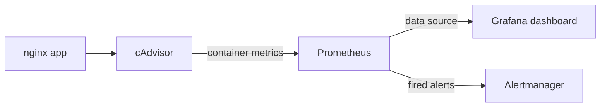

# Monitoring and Alerting Framework for Containerized Cloud Applications

A DevOps project that deploys a complete monitoring and alerting stack for Docker containers using **Prometheus, Grafana, Alertmanager and cAdvisor**. The whole stack is defined as code with Docker Compose and is automatically deployed and tested by a **GitHub Actions** CI pipeline on every push.


## Description

Modern cloud applications run as many containers, and failures can go unnoticed without monitoring. This project shows how to:

- collect CPU, memory and network metrics from running containers,
- store them as time-series data,
- visualise them on a live dashboard,
- raise an alert when monitoring itself breaks or a container fails, and
- verify all of this automatically through a CI/CD pipeline.

A sample **nginx** web server acts as the containerized application being monitored.

## Why this project

- **Observability** is a core DevOps practice. You cannot fix what you cannot see.
- **Infrastructure as Code:** every config (Prometheus, Alertmanager, Grafana data source and dashboard) lives in Git, so the setup is repeatable with one command.
- **Automation:** a pipeline proves the stack works on every change, instead of testing by hand.
- **No local Docker needed:** Docker Desktop was not available on my machine, so the stack is built and tested on GitHub Actions runners and viewed through GitHub Codespaces.

## Architecture



| Component | Role | Port |
|---|---|---|
| nginx (`web`) | Sample application being monitored | 8081 |
| cAdvisor | Collects per-container CPU, memory, network metrics | 8080 |
| Prometheus | Scrapes metrics every 5s, stores them, evaluates alert rules | 9090 |
| Alertmanager | Receives, groups and routes alerts | 9093 |
| Grafana | Dashboards, auto-linked to Prometheus | 3000 |
| Docker Compose | Starts the whole stack with one command | n/a |
| GitHub Actions | Validates, deploys and tests the stack automatically | n/a |

## Project structure

```
.
├── .github/workflows/monitoring.yml        # CI pipeline
├── alertmanager/alertmanager.yml           # alert routing
├── grafana/provisioning/
│   ├── datasources/datasource.yml          # links Grafana to Prometheus
│   └── dashboards/
│       ├── dashboards.yml                  # dashboard loader
│       └── containers.json                 # Container Monitoring dashboard
├── prometheus/
│   ├── prometheus.yml                      # scrape + alerting config
│   └── alerts.yml                          # alert rules
├── screenshots/                            # results
└── compose.yaml                            # all services
```

## What was done

1. Wrote `compose.yaml` to run nginx, cAdvisor, Prometheus, Alertmanager and Grafana together.
2. Configured Prometheus to scrape itself and cAdvisor every 5 seconds.
3. Defined the alert rule `ContainerMonitoringUnavailable`, which fires when cAdvisor is down for 30 seconds.
4. Connected Prometheus to Alertmanager so fired alerts are routed there.
5. Provisioned Grafana automatically: the Prometheus data source and a Container Monitoring dashboard (CPU and memory per container) load on startup with no manual setup.
6. Built a GitHub Actions pipeline that tests everything on each push.

## CI/CD pipeline

On every push to `main`, the workflow `.github/workflows/monitoring.yml`:

1. Validates the Prometheus config and alert rules with `promtool`.
2. Validates the Alertmanager config with `amtool`.
3. Validates the Compose file.
4. Starts the full stack with Docker Compose.
5. Runs health checks on Prometheus, Alertmanager, Grafana, cAdvisor and nginx.
6. Confirms Prometheus is scraping its targets.
7. Confirms Grafana has the Prometheus data source and the dashboard.
8. Stops cAdvisor on purpose and confirms the alert **fires in Prometheus**.
9. Confirms the alert **reaches Alertmanager**.
10. Uploads logs and alert output as build artifacts, then tears the stack down.

## How to run

**Locally (needs Docker):**

```bash
git clone https://github.com/VishakhaSingh123/monitoring-project.git
cd monitoring-project
docker compose up -d
```

**In GitHub Codespaces (no local Docker needed):** open the repo → **Code → Codespaces → Create codespace on main**, run `docker compose up -d`, then open the forwarded ports from the **Ports** tab.

| Service | URL | Login |
|---|---|---|
| Grafana | http://localhost:3000 | admin / admin |
| Prometheus | http://localhost:9090 | n/a |
| Alertmanager | http://localhost:9093 | n/a |
| cAdvisor | http://localhost:8080 | n/a |

**Trigger the alert yourself:**

```bash
docker compose stop cadvisor
```

After about 1 minute, `ContainerMonitoringUnavailable` appears as **FIRING** in Prometheus (Alerts) and in Alertmanager. Bring it back with `docker compose start cadvisor`.

## Results

- The CI pipeline passes on every push: configs validate, the stack deploys, all services report healthy, and the Grafana link and alert delivery checks succeed.
- Prometheus collects metrics from all targets.
- Grafana shows live CPU and memory graphs per container on the auto-loaded dashboard.
- Stopping cAdvisor raises the alert in Prometheus, and it is delivered to Alertmanager.

### Screenshots

| | |
|---|---|
| **Green CI pipeline** |  |
| **Prometheus targets (all UP)** |  |
| **Grafana dashboard** |  |
| **Alert firing in Prometheus** |  |
| **Alert in Alertmanager** |  |
| **cAdvisor** |  |

## Challenges and solutions

| Challenge | Solution |
|---|---|
| Docker Desktop not working locally | Ran and tested the stack on GitHub Actions runners and viewed it in GitHub Codespaces |
| Workflow not running | `.github/workflows/` must be a real folder; fixed the file location |
| Grafana showed no data source | Provisioning folders were misnamed; fixed and added a pipeline check so it cannot regress |

## Future improvements

- Send notifications to Slack or email through Alertmanager receivers (kept out of the public repo to avoid exposing webhook secrets).
- Add more alert rules (high CPU, high memory, container restarts).
- Add Node Exporter for host-level metrics.
- Pin image versions instead of `latest`.
- Deploy on Kubernetes using Helm.

## Tech stack

Docker, Docker Compose, Prometheus, Alertmanager, Grafana, cAdvisor, nginx, GitHub Actions, GitHub Codespaces

## Author

Vishakha Singh: [GitHub](https://github.com/VishakhaSingh123)